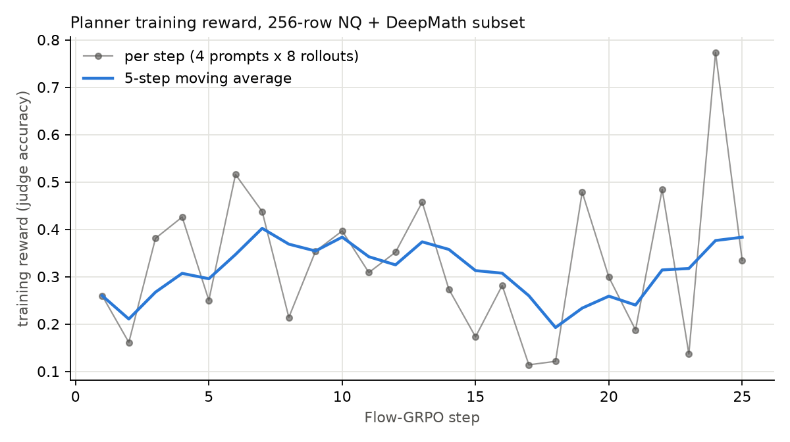

# Week 9 Part 1 — run report

All numbers in this report were measured on the node below unless they are
explicitly labelled **paper**. Paper values come from AgentFlow Table 1
(Bamboogle, Qwen-2.5-7B-Instruct).

## Results on Bamboogle (125 questions)

| System | Judge accuracy (local Qwen judge) | Rule-based EM | Paper (gpt-4o judge) |
| --- | ---: | ---: | ---: |
| Qwen-2.5-7B-Instruct, direct, no tools | 12/125 = **9.6%** | 8/125 = 6.4% | 12.0% |
| AgentFlow, base planner (no Flow-GRPO) | 36/125 = **28.8%** | 18/125 = 14.4% | 58.4% |
| AgentFlow, Flow-GRPO planner (LoRA, 25 steps) | 37/125 = **29.6%** | 16/125 = 12.8% | 69.6% |

**Main findings**

1. **AgentFlow beats the no-tool baseline by a wide margin** (9.6% → 28.8%,
   3×; rule EM 6.4% → 14.4%), reproducing the paper's first result even with a
   local Wikipedia snapshot instead of live Google search.
2. **25 LoRA Flow-GRPO steps did not measurably improve the planner on
   Bamboogle** (28.8% → 29.6%, +1 question by the judge; −2 by rule EM). The
   paper's second result (58.4% → 69.6%) is **not** reproduced at this budget.
   Per question, the trained planner gained 17 and lost 16 questions relative
   to the base planner (`agentflow_base_vs_flowgrpo.txt`), so the difference is
   within run-to-run noise (McNemar p ≈ 1).

- Scoring: `test/calculate_score_unified.py` with the official judge prompt,
  answered by the local Qwen2.5-7B-Instruct judge instead of gpt-4o (same
  judge for all three rows). Rule-based EM (normalized exact match of the
  `<answer>` text, as in Week 8) is reported as a deterministic second metric.
  Spot-checking the direct baseline, the 7B judge disagreed with EM on 6
  questions: 3 reasonable (typo "Cameron/Cameroon", "King George VI", "He" for
  Helium), 2 too lenient ("Germany" for "Oranienburg, Germany", "Pine State"
  for "Pine Tree State") and 1 false negative ("Boston" vs "Boston"), i.e. about
  ±2–3 questions of judge noise.
- The trained planner was evaluated once, at the final step; no checkpoint was
  selected with Bamboogle.

## Training (Flow-GRPO, LoRA)

| Setting | Value |
| --- | --- |
| Base model / trained module | Qwen2.5-7B-Instruct / planner only |
| LoRA | rank 16, alpha 32, dropout 0, q/k/v/o/gate/up/down |
| Data | 256-row deterministic subset (seed 42) of the official NQ + DeepMath training set: 110 NQ + 146 DeepMath (`mathhard`) rows |
| Batch | 4 prompts × 8 rollouts = 32 trajectories per step, GRPO advantages, KL loss 0.001, lr 1e-6 |
| Agent | max 3 planner steps per rollout, train temperature 0.7, test temperature 0.0 |
| Steps | 25 (planned 25; 100 was not attempted, see limitations) |
| Validation | AIME24 (30 problems) before training and every 10 steps |
| Runtime | 4 h 05 min of training wall time (3.6 h of step time, mean 522 s/step) on one GB300 (GPU 0) |

### Reward trend

| Steps | 1–5 | 6–10 | 11–15 | 16–20 | 21–25 |
| --- | ---: | ---: | ---: | ---: | ---: |
| Mean training reward | 0.296 | 0.383 | 0.313 | 0.259 | 0.383 |

The per-step reward is noisy (4 prompts per step, so a step's mean mostly
reflects which prompts were drawn) and shows **no sustained upward trend**:
the mean over steps 1–12 is 0.338 and over steps 13–25 0.316. Split by source
(`training_rollouts_by_source.csv`, rollouts assigned to trainer steps by time),
NQ reward went from 0.378 (first half) to 0.396 (second half) and DeepMath from
0.369 to 0.323. AIME24 validation stayed at 0.0 (steps 0, 10, 15, 25) except
2/30 at step 20. The policy barely moved: the KL loss stayed below 0.0006 and
the trained `lora_B` matrices have a mean norm of 0.003.

Because the reward did not keep rising, the run was kept at 25 steps rather
than extended to 100 (100 steps would also have taken about 15 GPU-hours).



Per-step metrics are in `training_metrics.csv`; compact training, reward,
export, scoring, and evaluation logs are in `logs/`. Full raw console captures
were omitted when transferring the run. The exported adapter is `flowgrpo-step25/lora_adapter/`
(rank 16, alpha 32, 77 MB).

## Example trace (trained planner)

Bamboogle question 14, answered correctly by the trained planner
(`bamboogle/AgentFlow-flowgrpo-step25/output_14.json`):

```text
Question: When was the author of The Population Bomb born?      Gold: May 29, 1932
Step 1  planner -> Local_Wikipedia_Search_Tool("author of The Population Bomb birth year")
        result: "The Population Bomb ... written by Stanford University Professor Paul R. Ehrlich ..."
        verifier: not enough yet; search "Paul R. Ehrlich date of birth"
Step 2  planner -> Local_Wikipedia_Search_Tool("Paul R. Ehrlich birth year")
        result: Docs 1-2 about Thomas Ehrlich (wrong person); Doc 3 "Paul Ralph Ehrlich (born May 29, 1932) is an American ..."
        verifier: "...born on May 29, 1932. This directly answers the query ... no additional tools are needed."
Final   <answer>May 29, 1932</answer>
```

`../scripts/show_trace.py OUTPUT_JSON` prints any trajectory in this form.

## Hardware, software, runtime

| Item | Value |
| --- | --- |
| Node | 1 × reserved node, 4 × NVIDIA GB300 (284 GB HBM each), aarch64 Grace CPU, 958 GB RAM |
| Driver / CUDA | 595.58.03 / CUDA 13.2 driver; CUDA 12.8 toolkit for building, CUDA 13.1 `ptxas` for Triton |
| Python stack | Python 3.11, torch 2.7.0+cu128, vLLM 0.9.2 (built from source), verl 0.5.0 (+ patch), flash-attn 2.8.1 (built from source), transformers 4.53.3, Triton 3.5.1 |
| GPU use | GPU 0: Flow-GRPO trainer + rollout vLLM; GPU 1: Qwen2.5-7B server (fixed modules, tools, judge, evaluation); GPU 2: wiki-18 retriever |
| Environment build (CPU) | CUDA 12.8 toolkit + flash-attn ≈ 25 min, vLLM 0.9.2 from source ≈ 45 min |
| Smoke run (final, 1 step) | 8 min 27 s |
| Flow-GRPO training | steps 1–15: 2 h 28 min; steps 16–25 after resuming from `global_step_15`: 1 h 37 min |
| Lost time | 22 min at step 16: the vLLM engine core of the fixed-module server died without an error; the step was discarded and training resumed from the step-15 checkpoint (model, optimizer, RNG, LR scheduler) |
| Direct baseline | generation 79 s, scoring 24 s |
| AgentFlow base / Flow-GRPO evaluation | 18 min 19 s / 26 min 35 s (125 questions, 8 in parallel) |
| GPUs | All jobs stopped and all four GPUs confirmed idle (0 MiB, no compute processes) after the last evaluation |

## Deviations from the paper

1. **No paid APIs.** Every non-trainable LLM (fixed planner, verifier,
   executor, Base_Generator, Python_Coder) is the same Qwen2.5-7B-Instruct
   served locally. The paper also uses Qwen2.5-7B for these modules (through
   DashScope), so the modules match; the serving is different.
2. **Search.** Google_Search_Tool (Gemini grounding on the live web) and
   Wikipedia_Search_Tool (OpenAI-based) are replaced by one
   `Local_Wikipedia_Search_Tool` returning the top-3 passages of the 2018
   Wikipedia dump (wiki-18, E5 dense index). This is weaker than live web
   search, so absolute AgentFlow scores are expected to be below the paper's.
3. **Judge.** The training reward and all scores use the official judge
   prompt with a local Qwen2.5-7B judge instead of gpt-4o.
4. **Compute.** 25 Flow-GRPO steps on 256 training rows instead of the
   paper's full run, as allowed by the course when the reward trend is shown.
5. **Bug fixes required for LoRA** (see `../README.md`): outcome reward
   propagation in `train/rollout.py`, LoRA reference log-probs in
   `agentflow/verl/trainer.py`, merged-weight sync for the async vLLM rollout
   server (`patches/`), and the exported adapter's `lora_alpha`.
6. **GB300/aarch64 environment.** The pinned stack has no working aarch64
   wheels for vLLM 0.9.2 and flash-attn 2.8.1, so both were built from source;
   Triton 3.5.1 (with CUDA 13.1 `ptxas`) replaced Triton 3.3.0, which cannot
   generate code on this host; `torch.compile` is disabled
   (`TORCHDYNAMO_DISABLE=1`) and vLLM runs in eager mode. Unpinned packages
   that `setup.sh` now resolves to newer releases were pinned back to
   compatible versions (openai 1.75.0, mcp < 2, datasets 3.6.0, pyarrow < 20,
   setuptools < 80, sympy 1.13.3). `data/get_train_data.py` was run through a
   small shim that casts `large_string` columns to `string` before
   concatenation (same rows and values).
7. **Bamboogle data.** The vendored copy was missing
   `test/bamboogle/data/data.json` (excluded by `.gitignore`); it was restored
   from the pinned upstream commit (git blob `7e71290e`, 125 questions).

## Limitations

- **Flow-GRPO gain not shown.** At 25 steps × 4 prompts the trained planner is
  indistinguishable from the base planner. The most likely cause is the
  learning rate: `config.assignment.yaml` keeps the official 1e-6, which was
  set for full fine-tuning; LoRA usually needs roughly 10× higher rates, and
  the tiny KL and `lora_B` norms show the adapter hardly changed. Next run:
  lr 1e-5–5e-5, a larger batch (e.g. 16–32 prompts per step) to reduce reward
  noise, and more steps. This was not tested here.
- **Absolute scores are not comparable to the paper**: local 2018 Wikipedia
  search instead of live Google search, and a 7B judge instead of gpt-4o.
- **Single seed, single evaluation.** Even at temperature 0, concurrent vLLM
  batching makes trajectories differ between runs; the 17-gained/16-lost
  per-question churn between the two AgentFlow runs shows that differences of a
  few questions are noise.
- The run was resumed once from a checkpoint (see runtime); steps 16–25 used
  freshly sampled batches from the resumed data loader.
